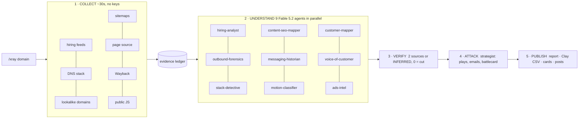

<div align="center">

# GTM X-Ray

### Reverse-engineer any company's go-to-market from public data.<br>Then get the plan to take their customers.

**12 Claude Fable 5.2 agents · 8 collectors · zero API keys · every claim linked to its public source**

Built by **[Frontal](https://frontal.so)**: we help B2B companies build pipeline.

[Why](#why-this-exists) · [What a run gives you](#what-a-run-gives-you) · [Features](#features) · [Setup](#setup) · [Use it](#use-it) · [How it works](#how-it-works) · [vs the market](#how-it-compares) · [Limits](docs/LIMITATIONS.md)


</div>

---

## Why this exists

Every company publishes its go-to-market by accident.

- **Job posts** say who they sell to, what deal sizes they chase, which regions they are entering and which tools they run.
- **DNS** says which tools they connected. **Lookalike domains** give away the cold email machine.
- **Sitemaps** show the content engine, page by page. **Comparison pages** name the rivals they attack.
- **The Internet Archive** keeps every headline and price they ever tried.
- **The JavaScript on their homepage** names their analytics events and experiment platform.

Reading all of that by hand takes a day per company, and most of it gets skipped. Asking a chatbot gives you
a confident summary you cannot check.

GTM X-Ray does the reading in about 30 seconds, hands the evidence to a team of Claude Fable 5.2 agents, makes a
verifier cut anything without a source, and **ends with the part that makes money**: who already uses the
competitor, why they would talk to you this month, the emails to send, and a Clay-ready CSV.

> Reading the GTM is step one. The list and the emails are the point.

## What a run gives you

Run `/xray competitor.com` and about 15 minutes later you have one folder with:

| Output | What is in it |
|---|---|
| `report.html` | A single-file dashboard (light/dark, prints to PDF): headline verdict, GTM motion radar, attack plan, displacement targets, hiring roadmap, outbound forensics, tool stack, content engine, positioning timeline, battlecard, leak score, unknowns, and the full evidence ledger with a source link on every claim. |
| `clay-import.csv` | Accounts that already use the competitor, ranked by independent evidence, each with a "why now" line and target titles. Imports straight into a Clay table. |
| `analysis.json` | The strategist's verdict, predictions, 3-5 plays with 3-email sequences, battlecard and unknowns. |
| `facts.json` · `roles.json` · `ledger.jsonl` | Every raw fact, every open role classified, every piece of evidence. |
| `card-*.png` | 1200x675 social cards with the strongest numbers, ready to post. |
| `leak-badge.svg` | The company's GTM leak score as a README badge. |

Typical findings from one run: how many open roles sit in sales vs engineering and which regions get the GTM
headcount; the deal sizes their AE job posts ask for; a founding SDR or first RevOps hire; lookalike domains wired
for cold email and the tool sending from them; thousands of programmatic SEO pages and the rivals their comparison
pages attack; the experiment platform in their JavaScript; their headline and entry price year by year; the
customers named on their own site and in their hiring copy.

## Features

| | Feature | What it answers |
|---|---|---|
| 🎯 | **Displacement Engine** | *Who uses this competitor right now?* Job posts at other companies that name the product (verified by fetching each one), HN hiring posts, the competitor's own logo wall, case studies and job-post blurb. Merged, ranked by independent sources, exported to Clay. |
| 📮 | **Outbound forensics** | *Do they cold email, from where, with what?* ~100 lookalike domains checked for MX, redirect back to the company, and tracking CNAMEs (Instantly, Smartlead, lemlist). Capacity estimate with the arithmetic printed. |
| 🧭 | **Hiring = roadmap** | AE/SDR ratio, enterprise push, new regions, first and founding hires, deal sizes in job posts, the stack named in their own job descriptions, customers named in their hiring blurb. |
| 🧰 | **Stack detective** | Tools from DNS verification records, SPF, page source and network calls. Experiment vendors, analytics events and feature flags from public JavaScript. |
| 🗺️ | **Content & SEO engine** | Every sitemap counted by folder. Programmatic SEO found. Rivals attacked with comparison pages. Languages localized. |
| ⏳ | **Positioning time machine** | Homepage headline and pricing per year from the Internet Archive. When AI entered the pitch. Flags old captures that belonged to a previous owner of the domain. |
| 🔬 | **Funnel X-Ray** | Public JS bundles, network calls, CTAs and form fields (what the demo form asks = their qualification criteria). `--browser` for a real network log and screenshots. `xray har` for a capture of your own trial. |
| ⚔️ | **Attack plan + battlecard** | 3-5 plays, each built on evidence, with a trigger, targets, steps and a 3-email sequence. They-win-when, they-lose-when, landmine questions, objections. |
| 🔒 | **GTM leak score** | `/xray-self`: what your own site tells competitors, scored 0-100, with a fix list and a README badge. |
| 📊 | **Compare + market map** | `/xray-compare a b c` and `/xray-market "AI app builders"`: radar overlay, who leads which motion, the white space. |
| 🔔 | **Weekly war room** | GitHub Action: re-run every Monday, diff against last week (new SDR roles, new sending domain, price change, new comparison page), Slack digest, Claude-written brief. |
| 🤝 | **Agency audit mode** | `/xray-audit prospect.com`: a client-ready GTM audit and call prep before the sales call. |
| ✍️ | **Content engine** | `/xray-content`: X post, thread, article, LinkedIn post and carousel from a run, in your voice pack. Every number from the ledger. 1200x675 social cards rendered for you. |
| 🔁 | **Recreate** | `/xray-recreate them.com for us.com`: rebuild the mechanism that works for them, for you. Mechanism, not content. |

### The evidence ledger (the reason you can trust it)

Every collector writes what it saw, where, and how, to `ledger.jsonl`. Every claim in the report links to a row.

```json
{"id": "ev_8c41d2a9f0", "module": "outbound", "kind": "SEEN",
 "claim": "inst.tryacme.com is a tracking domain for Instantly",
 "source_url": "dns:CNAME inst.tryacme.com", "method": "CNAME fingerprint", "confidence": 0.85}
```

`SEEN` = read off a public source. `INFERRED` = a conclusion from SEEN facts, with a confidence.
`ESTIMATE` = arithmetic with the assumptions printed. A verifier agent cuts anything without a source and
downgrades anything with only one.


## Setup

You need **Python 3.12+**, **[uv](https://docs.astral.sh/uv/)**, and **[Claude Code](https://claude.com/claude-code)** for the agents.

### 1. Claude Code plugin (recommended: everything)

```bash
/plugin marketplace add thoughtpilot99/gtm-xray
/plugin install gtm-xray@gtm-xray
```
Switch to Claude Fable 5.2 and run it:
```
/model claude-fable-5-2
/gtm-xray:xray competitor.com
```
The plugin brings 12 agents, 8 commands, the `gtm-xray` skill and the MCP server (started automatically).

### 2. Any MCP client (Claude Desktop, Codex, Cursor, Gemini CLI)

```bash
uvx --from git+https://github.com/thoughtpilot99/gtm-xray xray setup --agents claude,codex,cursor,gemini
```
Setup shows every change first, backs up each config file and asks before writing. Restart your agent, then ask:
*"X-ray competitor.com and build me an attack plan."* Agents without subagents can follow `AGENTS.md` and run the
prompts in `agents/` one after another.

### 3. Just the collectors (CLI, no LLM)

```bash
git clone https://github.com/thoughtpilot99/gtm-xray && cd gtm-xray
uv sync
uv run xray collect competitor.com               # ~30s → runs/competitor.com/<date>/
uv run xray render competitor.com                # → report.html
uv run xray compare competitor-a.com competitor-b.com
```

### Optional extras

```bash
uv sync --extra render && uv run playwright install chromium   # --browser scans, screenshots, PNG cards
export SLACK_WEBHOOK_URL=...                                   # watch-mode digests
```

### Headless / CI

```bash
claude -p --model claude-fable-5-2 --plugin-dir . \
  --allowedTools "Bash(uv run *)" "Read" "Write" "Edit" "Grep" "Glob" "WebSearch" "WebFetch" "Agent" "mcp__*" \
  "/gtm-xray:xray competitor.com"
```
Allow `Bash(uv run *)` and the MCP tools, or the subagents cannot run the collectors (they then say so and work from the files).
For a weekly schedule, set the repo variable `XRAY_WATCH` (e.g. `competitor-a.com competitor-b.com`) and the secrets
`SLACK_WEBHOOK_URL` / `ANTHROPIC_API_KEY`; [`.github/workflows/xray-watch.yml`](.github/workflows/xray-watch.yml) does the rest.

## Use it

| Command | Does |
|---|---|
| `/xray <domain>` | Full teardown: collect, 9 investigators in parallel, verifier, strategist, report, Clay CSV |
| `/xray-compare <a> <b> [...]` | Side-by-side matrix + radar overlay + 10-line verdict |
| `/xray-market "<category>"` | Find the top players, X-ray all, rank them, name the white space |
| `/xray-self <your-domain>` | Leak score, what competitors learn about you, fix list, badge |
| `/xray-audit <prospect>` | Agency mode: client-ready audit + 6-bullet call prep |
| `/xray-watch <domain>` | Re-run and explain what changed since last time |
| `/xray-content <domain> [voice-pack]` | X post, thread, article, LinkedIn post, carousel + social cards |
| `/xray-recreate <them> for <us>` | Rebuild their winning mechanism for you, with a 30-day plan |

**CLI:** `xray collect | render | compare | accounts | verify-jobs | hn | queries | fetch | diff | notify | badge | har | setup | mcp`

**MCP tools:** `xray_collect` · `xray_facts` · `xray_ledger` · `xray_displacement_queries` · `xray_verify_jobs` ·
`xray_hn_hiring` · `xray_accounts` · `xray_fetch` · `xray_render` · `xray_diff` · `xray_har`

**What you get per run** (`runs/<domain>/<date>/`): `report.html` · `facts.json` · `roles.json` · `ledger.jsonl` ·
`analysis.json` · `accounts.json` · `clay-import.csv` · `card-*.png` · `leak-badge.svg` · `diff.json` (watch)

## How it works



- **Collectors** are plain Python (`src/gtmxray/`): Ashby, Greenhouse, Lever, Workable and SmartRecruiters public
  feeds; dnspython with TCP fallback; sitemap index crawling; the Wayback CDX API; static or headless-browser
  page and JS analysis. Job-post boilerplate is detected and stripped before tools are counted.
- **Agents** (`agents/*.md`) are Claude Code subagents pinned to `claude-fable-5-2`. Fable 5.2's 1M-token context
  lets the strategist read every finding, the full ledger and the raw job feed in one pass.
- **The skill** (`skills/gtm-xray/SKILL.md`) holds the method, the finding shape and the `analysis.json` contract.
- Details: [docs/HOW-IT-WORKS.md](docs/HOW-IT-WORKS.md).

## How it compares

| | Manual teardown / one-prompt method | Competitive-intel platforms | Technographic databases | **GTM X-Ray** |
|---|---|---|---|---|
| Time per company | hours | set-up + subscription | lookup | **~30 s collect, agents in minutes** |
| Hiring roadmap, deal sizes, regions | by hand | partial | no | **yes, every role classified** |
| Hidden cold email infrastructure | rarely | no | no | **yes, with sending tool** |
| Content engine and rivals targeted | by hand | partial | no | **yes, every sitemap** |
| Who uses the competitor | no | no | tool installs only | **yes, with a "why now" per account** |
| Attack plan with emails | no | battlecards | no | **yes, built on the evidence** |
| Every claim traceable | depends | varies | no | **ledger row per claim** |
| Your own exposure | no | no | no | **leak score + fixes** |
| Cost | your time | subscription | subscription | **free, MIT, your own Claude usage** |

## Tested

- `uv run pytest -m "not live"`: 12 offline tests (collectors, classification, boilerplate stripping, sitemap
  parsing, pricing extraction, capacity math, leak score, displacement ranking, ledger, rendering).
- `uv run pytest -m live`: live smoke test against a real domain.
- End-to-end runs on live companies with Claude Fable 5.2 before release. They caught and fixed: null-MX domains
  counted as senders, job-post boilerplate inflating tool counts, archive pages blocked for WebFetch (now
  `xray fetch`), investor and person names in customer lists (now filtered, plus `--exclude`).

## Responsible use

Public data only: public pages, public job feeds, public DNS, the Internet Archive, public ad libraries.
No logins, no form submissions, no private APIs, no personal data beyond what a company publishes about its own
roles. HAR analysis is for captures of your own sessions. People's names are filtered out of account lists.
See [DISCLAIMER.md](DISCLAIMER.md), [SECURITY.md](SECURITY.md) and [docs/LIMITATIONS.md](docs/LIMITATIONS.md).

## Built by Frontal

GTM X-Ray is made and maintained by **[Frontal](https://frontal.so)**.

Frontal helps B2B companies build pipeline. We build the system that grows it inside the tools you already use, so you own it, and we can run it for you across outbound, ads and content. GTM X-Ray is the kind of research we do before building that system: who your competitors sell to, how they reach them, and which of their customers you can win.

Want the plan run for you, not just the report? **[Talk to Frontal at frontal.so](https://frontal.so)**.

## Contributing

Fingerprints, ATS adapters, sharper agent prompts and voice packs are the most useful PRs. See [CONTRIBUTING.md](CONTRIBUTING.md).

## License

MIT licensed, © 2026 [Frontal](https://frontal.so). See [LICENSE](LICENSE).
